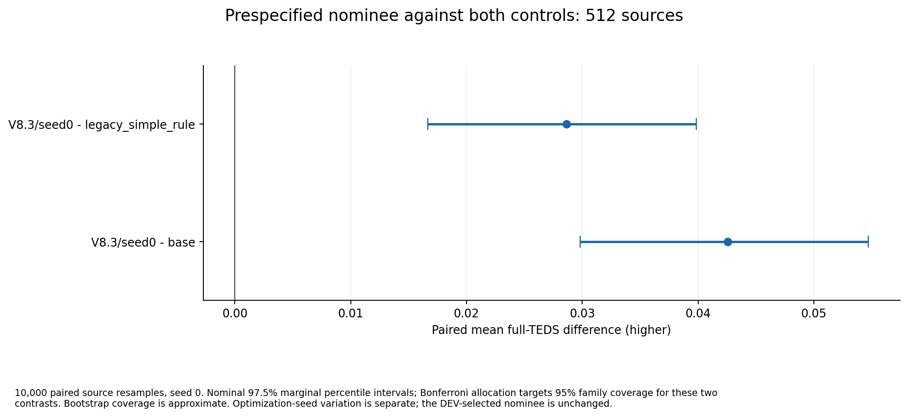
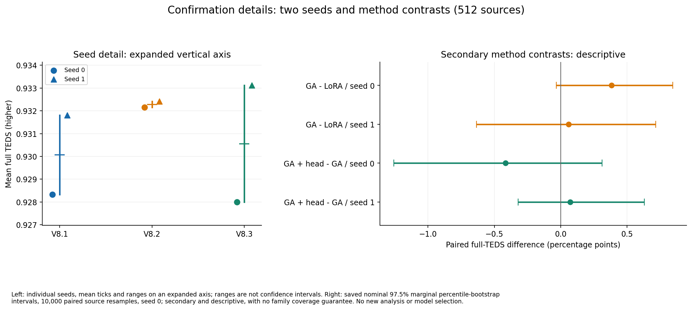
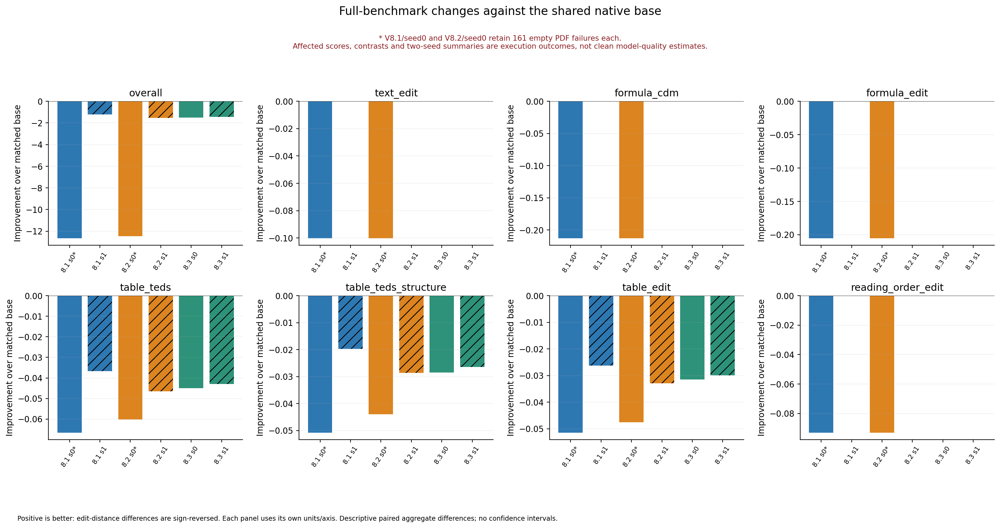

# V8 large LoRA campaign: completed results

Completed October 11, 2026. All six fits, 18 DEV checkpoints, eight confirmation policies and eight full-benchmark policies are accounted for. The prespecified **V8.3/seed0** nominee improves full TEDS on the 512-source confirmation cohort, but **loses table quality on the full 1,651-page benchmark**. The current evidence does not support replacing the native base parser for general full-document use.

The confirmation gain over the native base is **+4.2541 percentage points**. On the full benchmark, the same nominee's table TEDS is **0.924711 versus 0.969623**, a **4.4912-point decline**; Overall is **96.042049 versus 97.539151**. These are matched Transformers results. They are not comparisons to historical vLLM runs or an official leaderboard submission.

> **Retained execution failures:** V8.1/seed0 and V8.2/seed0 each include 161 empty outcomes from a PDF assembly defect. Their scores, affected contrasts and two-seed summaries describe execution outcomes, not clean model-quality or training-effect estimates. These failures do not affect confirmation, either V8.3 seed, or the other two seed1 runs. All denominators and original attempts are preserved.

## Design and completed training

The questions were whether table supervision improves native generation, whether LoRA-GA initialization adds benefit over ordinary LoRA, and whether a training-only cell-location objective adds benefit over LoRA-GA. V8.1/V8.2/V8.3 retain the historical V7.3.0/V7.3.1/V7.3.2 aliases in immutable evidence paths.

TRAIN contains **20,000 real tables from 11,217 documents**, balanced across eight prespecified structure strata, with a four-table document cap. Document-disjoint DEV and confirmation retain 256 and 512 sources. Native processing covered 21,535 source pages; 23,619 static-eligible targets received QA dispositions and 22,973 had usable native inputs before final TRAIN selection. The 200 visually reviewed examples remain in TRAIN. The [dataset card](DATASET_CARD.md) documents provenance, label encoding, rejection reasons, overlap checks, licensing limits and the [four dataset figures](DATASET_FIGURES.md). Accepted counts do not establish universal annotation correctness or independence from unknown base-model pretraining data.

All fits used default predicted native table crops at 200 DPI. Transformers was the approved common backend; presence/frequency penalties from the historical vLLM setup are not applied. All arms train 2,293,760 FP32 rank-8 adapter elements and the 31,464,704-element FP32 visual merger, keeping the remaining base weights frozen. V8.2 adds shared TRAIN-only gradient initialization from 256 calibrated examples and preserves the initial-function compensation. V8.3 adds a 4,100-parameter cell-box head with coefficient 0.1 on normalized box L1; generation does not use that head. Exact losses, normalization, learning rates and source hashes are in [METHODS](METHODS.md) and the [execution specification](EXECUTION_SPECIFICATION.json).

Each fit completed 3,750 updates, 60,000 exposures and 46,376,895 supervised target tokens. All 22,506 scalar records and 192 fixed-panel observations are retained, with no reported skipped or nonfinite updates. Generation CE falls in every run; final DEV panel CE is approximately 0.0082-0.0087 from 0.033416. Geometry loss also falls. These optimization results did not guarantee full-document transfer. The [training analysis and seven figures](TRAINING_ANALYSIS.md) preserve exact trajectories, throughput, memory and all 18 DEV endpoints.

Selected epochs are V8.1 **2/1**, V8.2 **3/2**, and V8.3 **3/1** for seeds 0/1. Selection used full DEV TEDS with earlier-epoch tie breaking. Twelve missing native DEV inputs remain in its denominator. The recipe-mean rule nominated V8.3/seed0 before independent evaluation; neither confirmation nor benchmark scores changed this selection. DEV-selected scores are selection-biased descriptive evidence.

## Independent confirmation: improvement within this cohort

All **512** sources are retained, including 20 missing native inputs per policy. Both primary contrasts use 10,000 paired source bootstrap resamples, seed 0. Intervals below are **nominal 97.5% marginal percentile intervals**; Bonferroni allocation targets 95% coverage for the two fixed primary contrasts. Bootstrap coverage is approximate, not guaranteed. A percentage point (pp) is 0.01 TEDS.

| Nominee versus | TEDS gain (pp) | Nominal 97.5% interval (pp) | Gain / harm / tie | Exact-table repair / harm |
| --- | --- | --- | --- | --- |
| base | 4.2541 | [2.9812, 5.4708] | 331 / 34 / 147 | 216 / 11 |
| legacy_simple_rule | 2.8623 | [1.6641, 3.9864] | 286 / 43 / 183 | 182 / 14 |

Both primary lower bounds are positive. The former 0.005-TEDS promotion diagnostic also passes, but it does not override the completed full-benchmark regression or authorize deployment. The nominee has 212 either-unmatchable-grid pairs versus base and 190 versus legacy; these pairs remain in the analysis. Its exact-table fraction is 320/512, compared with 115/512 for base and 152/512 for legacy.

| Policy | Full TEDS | Structure TEDS | Character distance (lower) | Exact-table fraction |
| --- | --- | --- | --- | --- |
| base | 0.885459 | 0.911874 | 0.095453 | 0.224609 |
| legacy_simple_rule | 0.899376 | 0.919413 | 0.086917 | 0.296875 |
| V8.1/seed0 | 0.928331 | 0.932588 | 0.053979 | 0.607422 |
| V8.1/seed1 | 0.931808 | 0.935206 | 0.053789 | 0.613281 |
| V8.2/seed0 | 0.932156 | 0.935065 | 0.052981 | 0.642578 |
| V8.2/seed1 | 0.932411 | 0.935676 | 0.051731 | 0.636719 |
| V8.3/seed0 | 0.927999 | 0.931618 | 0.056429 | 0.625000 |
| V8.3/seed1 | 0.933118 | 0.936704 | 0.051315 | 0.615234 |

The nominee improves both structure and text endpoints relative to controls: structure TEDS rises from 0.911874 to 0.931618 and character distance falls from 0.095453 to 0.056429 versus base. Its malformed count is 23 and missing count is 20; these counts overlap and must not be added as distinct failures. There are no recorded truncations. [All endpoints and 16 contrasts](confirmation/metrics/CONFIRMATION_AGGREGATE.json), [metric CSV](confirmation/metrics/CONFIRMATION_METRICS.csv) and [paired CSV](confirmation/metrics/CONFIRMATION_COMPARISONS.csv) retain all policies, gains, harms, ties, exact-table repairs and unmatchable grids.

## Added method effects and seed variability

| Registered secondary contrast | TEDS difference (pp) | Nominal 97.5% interval (pp) |
| --- | --- | --- |
| V8.2/seed0 - V8.1/seed0 | +0.3825 | [-0.0324, 0.8446] |
| V8.2/seed1 - V8.1/seed1 | +0.0603 | [-0.6350, 0.7171] |
| V8.3/seed0 - V8.2/seed0 | -0.4156 | [-1.2581, 0.3117] |
| V8.3/seed1 - V8.2/seed1 | +0.0707 | [-0.3215, 0.6294] |

These four registered secondary comparisons are descriptive. Every displayed interval crosses zero, and there is no family-coverage guarantee for this secondary set. The data do not establish a reliable additional benefit from gradient initialization or cell-location supervision under this schedule. They also do not establish equivalence or a general failure of either method. The V8.3-minus-V8.2 point estimate changes sign across seeds.

| Recipe | Confirmation mean | Confirmation seed range | Benchmark TEDS mean | Benchmark seed range |
| --- | --- | --- | --- | --- |
| V8.1 * | 0.930069 | 0.928331 - 0.931808 | 0.917970 | 0.902986 - 0.932953 |
| V8.2 * | 0.932283 | 0.932156 - 0.932411 | 0.916267 | 0.909443 - 0.923091 |
| V8.3 | 0.930559 | 0.927999 - 0.933118 | 0.925702 | 0.924711 - 0.926694 |

The asterisks apply to **benchmark** V8.1/V8.2 summaries because of their seed0 technical failures; their confirmation summaries are unaffected. Two seeds provide individual values and a descriptive mean/range, not a reliable seed-level confidence interval. The best confirmation individual score occurs at V8.3/seed1, but the frozen nominee remains V8.3/seed0.

The cohort is source-backed biomedical/publication material. Frozen strata use merged **column headers**, large tables (at least 25 rows or eight columns), and explicit blank cells. The eight strata are descriptive, not additional significance tests:

| Merged header | Large | Blank | Sources | Nominee minus base (pp) | Nominee minus legacy (pp) |
| --- | --- | --- | --- | --- | --- |
| 0 | 0 | 0 | 181 | +3.2010 | +2.0115 |
| 0 | 0 | 1 | 87 | +4.6776 | +3.2987 |
| 0 | 1 | 0 | 40 | +2.8366 | +1.2445 |
| 0 | 1 | 1 | 39 | +5.3829 | +4.7442 |
| 1 | 0 | 0 | 47 | +3.1465 | +0.8382 |
| 1 | 0 | 1 | 55 | +8.3792 | +7.6335 |
| 1 | 1 | 0 | 24 | -0.0438 | -2.1420 |
| 1 | 1 | 1 | 39 | +6.6838 | +4.4052 |

The merged-header/large/no-blank stratum has only 24 sources and a negative nominee contrast against both controls. Aggregate improvement is therefore not uniform across table structures. No financial, universal-domain or multilingual coverage is inferred from these results. The [stratum source table](confirmation/metrics/STRATA.csv) preserves every policy and denominator.

## Full benchmark: table replacement reduces quality

Every policy has the same **1,651-page evaluation universe**. Official component denominators differ: table metrics cover 458 scored pages and the paired table supplement covers 665 uniquely identified official table rows; these are not 1,651 separate tables. Original official targets were not normalized to favor the models.

| Policy | Overall (0-100) | Table TEDS | Structure TEDS | Table edit (lower) | Retained PDF failures |
| --- | --- | --- | --- | --- | --- |
| base | 97.539151 | 0.969623 | 0.982959 | 0.034118 | 0 |
| legacy_simple_rule | 97.419767 | 0.966041 | 0.981646 | 0.037184 | 0 |
| V8.1/seed0 * | 84.879353 | 0.902986 | 0.932127 | 0.085605 | 161 |
| V8.1/seed1 | 96.316806 | 0.932953 | 0.963210 | 0.060427 | 0 |
| V8.2/seed0 * | 85.094576 | 0.909443 | 0.938920 | 0.081719 | 161 |
| V8.2/seed1 | 95.988052 | 0.923091 | 0.954352 | 0.067085 | 0 |
| V8.3/seed0 | 96.042049 | 0.924711 | 0.954394 | 0.065634 | 0 |
| V8.3/seed1 | 96.108150 | 0.926694 | 0.956492 | 0.064097 | 0 |

All four model runs unaffected by the PDF defect score below **both** matched controls in full-benchmark table TEDS. Thus the nominee's regression cannot be attributed to the two separate seed0 failures. The clean seed1 LoRA-GA-minus-LoRA table-TEDS difference is -0.9863 pp; adding the head to LoRA-GA gives +0.3603 pp for seed1, while remaining below base. The affected seed0 comparisons cannot supply a clean two-seed method-effect estimate.

For nominee versus base, the 665 paired official table rows contain **47 improvements, 378 harms and 240 ties**, with zero unmatchable table rows. Nine reach metric-perfect TEDS and 182 lose it; metric-perfect is not necessarily literal output-text equality. At the page level, table TEDS improves on 28 pages, worsens on 294 and ties on 136; the other 1,193 pages have an absent component or unavailable score and remain explicitly unmatchable in this component analysis. These outcomes are descriptive, without a significance claim.

The [eight-field table](benchmark/metrics/METRICS.md), [CSV](benchmark/metrics/METRICS.csv) and [full aggregate with official category breakdowns](benchmark/metrics/AGGREGATE.json) include text edit, formula CDM, formula edit, table TEDS, structure TEDS, table edit, reading-order edit and Overall. The [paired supplement](benchmark/metrics/PAIRED_OUTCOMES.json) includes all 16 comparisons, exact correspondence rules and component denominators. It does not silently match duplicate identities or impute favorable scores for absent components.

Formula metrics are unchanged in the clean model runs. Text and reading-order aggregate shifts are tiny but are preserved exactly; native/non-table preservation checks do not imply identical whole-document evaluator matching. The large non-table score losses in the two affected seed0 runs include empty whole-page failure outcomes and must not be called catastrophic forgetting.

The observed pattern is consistent with a specialization/transfer gap. This experiment does not isolate whether training-domain coverage, representation conventions, input properties or other factors caused it. Falling teacher-forced loss and confirmation gains are insufficient evidence for broad parser replacement.

## Execution integrity, cost and deliverables

The PDF defect opened cached pages with a backend incompatible with native output assembly. Each affected original attempt retained 160 durable failed pages plus one started page conservatively excluded from further inference. A separately versioned correction processed only 1,490 unattempted pages per affected model. No completed fit, DEV inference, attempted model page or official score was repeated. The [correction record](EVALUATION_PIPELINE_CORRECTION.json) and qualified aggregates preserve the failures and their costs. The 32 earlier candidate synthetic tables are not counted in the 20,000-real-table formal corpus.

The campaign used **263.0598 allocated GPU-hours** across 363 allocations, including waiting and failed attempts, with shared work counted once:

| Stage group | Allocations | Allocated GPU-hours |
| --- | --- | --- |
| preparation and technical checks | 6 | 0.0377 |
| native input preparation | 265 | 38.5473 |
| shared gradient calibration | 1 | 0.0499 |
| DEV generation | 18 | 30.9675 |
| formal training | 6 | 81.4435 |
| shared benchmark | 52 | 28.5159 |
| model benchmark | 8 | 57.2736 |
| confirmation generation | 7 | 26.2243 |

Allocated device time is not elapsed wall time. Across 358 timestamped allocations, the measured first-start-to-last-finish GPU window is **69.8917 hours**, while the occupied union is **58.6805 hours**. Five early allocation records lack timestamps; their device seconds remain in total costs. These windows exclude work before the first GPU launch, later CPU scoring, packaging, review and publication. The [timing ledger](benchmark/metrics/EXECUTION_TIMING.json) keeps those distinctions. Summed official CPU evaluator elapsed time across eight policies is **4.1549 hours**, not CPU-core hours and not campaign elapsed time.

Shared controls include whole-document base processing and an extra planned legacy read, whereas model increments replace table generation. Legacy uses its frozen 0.535299427146522 per-dimension resize with PIL Lanczos, rounding and a one-pixel minimum. Confirmation base/legacy are two planned reads per usable input; learned models use one native read. These workload differences and cache waiting prevent a clean throughput comparison from allocation hours alone. Formal fits used A100 80GB PCIe cards, with physical GPU0 excluded by the resource contract.

All six selected local model packages passed checkpoint-hash, base/runtime provenance, bundled-source and FP32 safetensors layout checks. Reconstruction requires the trained visual merger and, for GA models, initial compensation factors alongside adapters. The training-only head is stored for V8.3 but unused during generation. Package checks did not add model reloads or quality claims. [Public package metadata](MODEL_PACKAGES.json) records sizes, hashes and component counts; weights remain in the existing local artifact directory and are not uploaded to Git.

The [compute closure receipt](COMPUTE_CLOSURE.json) confirms all 363 allocations closed, zero campaign worker processes, zero owned GPU processes and zero running score containers. Four historical allocations ended as failed and 359 as passed; both dispositions are retained. All seven final official scoring stages/eight policies exited normally. A local command-length failure in the read-only paired-summary transport was resolved by streaming the unchanged reducer through SSH stdin; it caused no inference or rescoring.

One earlier metadata inspection accidentally displayed a truncated subset of completed V8.3/seed0 confirmation per-source scores. Nomination was already frozen; no aggregate was interpreted then and no experimental choice changed afterward. This disclosure is retained rather than claiming complete blinding throughout. Other limits include two optimization seeds, one assistant visual reviewer, unknown pretraining overlap, domain-limited confirmation and the explicit benchmark failures.

The final [figure index](FIGURES.md) adds eight result figures as PNG/SVG to the four dataset and seven training figures already published. [Figure QA](FIGURE_QA.json), [reporting-source hashes](REPORTING_SOURCE_MANIFEST.json) and the [delivery manifest](FINAL_DELIVERY_MANIFEST.json) bind the reviewed outputs. Earlier [progress text](historical/REPORT_20261010.md) is preserved as a historical snapshot.

## Decision and scope

Retain the native base parser as the general full-document reference. Preserve the six selected models as research artifacts and the frozen nominee for reporting; do not select a replacement from these benchmark scores. Confirmation supports cohort-specific improvement, while full-benchmark retention failed. Further work should begin with a separately planned error and representation audit using the saved results, followed by a prospectively specified intervention if warranted. This campaign makes no leaderboard-rank, universal-domain, dataset-size scaling or publication-acceptance claim, and launches no additional training sweep.
