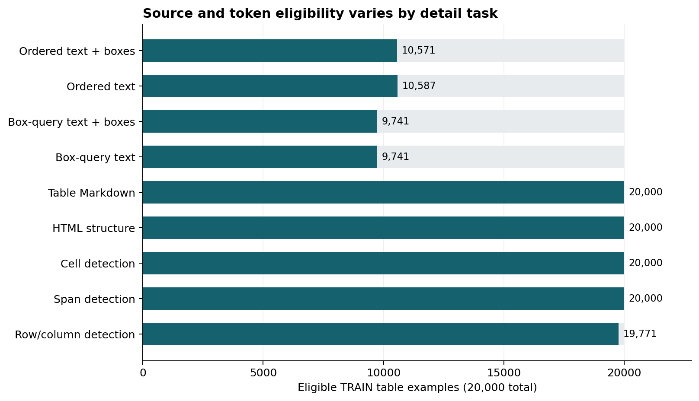
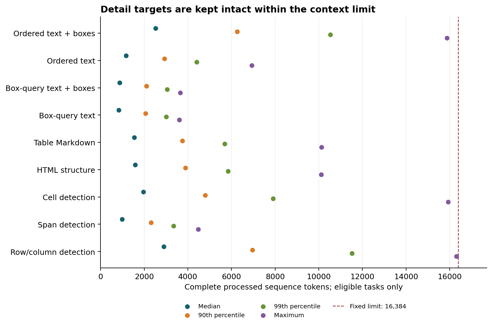
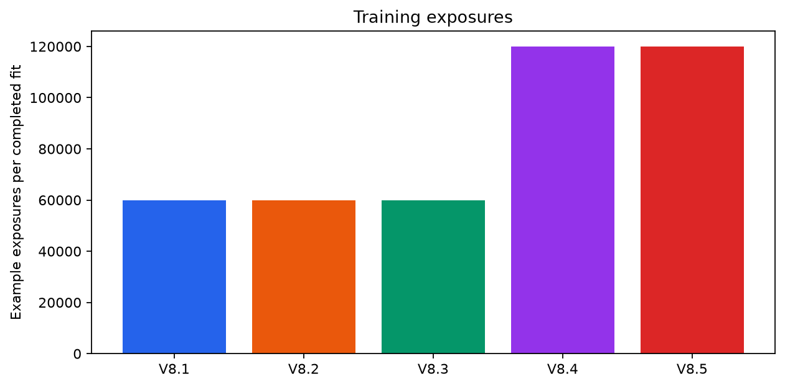

# V8.4 / V8.5 dataset and frozen protocol

Status: both fits and official evaluations are complete. This page records the
frozen inputs and design; [the numerical results](RESULTS.json) presents the measured results. V8.4 uses ordinary LoRA and V8.5 uses LoRA-GA; both receive the same
TDATR-style adapted detail and fusion supervision. Each is one formal fit.

## Cohorts and input identity

The unchanged TRAIN cohort contains **20,000 tables from 11,217 unique sources**,
with 1,783,555 cells, 107,506 empty cells and 90,138 spanning cells. DEV retains
256 sources:244 original native inputs and 12 original missing inputs. Confirmation
retains 512 sources, and each selected model receives the same 1,651 benchmark pages.
No new synthetic or real examples are added in this campaign.

The full audit accounts for 20,256 table examples and exactly reconstructs all
20,244 eligible native caches and full-cell token ranges. This item count is not
a count of unique TRAIN source documents. The [terminology note](PROTOCOL_TERMINOLOGY_NOTE.json)
clarifies that distinction without changing the frozen executable protocol.
All tasks preserve the original predicted 200 DPI crop and image tensors. Targets
are not truncated; a task without valid annotations or within-limit tokens stays
unavailable while its table remains in the original training cohort.

| Detail task | Eligible TRAIN tables | Exposures in each new fit |
| --- | ---: | ---: |
| Ordered text + boxes | 10,571 | 6,667 |
| Ordered text | 10,587 | 6,667 |
| Box-query text + boxes | 9,741 | 6,666 |
| Box-query text | 9,741 | 6,666 |
| Table Markdown | 20,000 | 6,667 |
| HTML structure | 20,000 | 6,667 |
| Cell detection | 20,000 | 6,666 |
| Span detection | 20,000 | 6,667 |
| Row/column detection | 19,771 | 6,667 |

Box queries need complete source-verified text lines and a proper subset region.
Row/column labels outside the native frame and sequences above 16,384 tokens are
unavailable for that task. Sixteen ordered spotting and 27 row/column tasks exceed
the limit. The longest eligible detail sequence is 16,299 tokens. Full-cell pooling
retains tokens that straddle adjacent cells;306,128 such incidences are audited.

## Detail and fusion training

Each new model receives three complete detail passes followed by three native
OTSL fusion passes:60,000 exposures per stage and 120,000 total. Batch one and
16-example accumulation give 3,750 updates per stage and 7,500 per model. Identical
realized epoch orders and detail assignments are frozen once using system entropy.
Both methods use the same saved localizer initialization at the stage transition. V8.5's fresh 256-example TRAIN
gradient calibration uses its first assigned detail targets, with no optimizer
updates; it preserves the original initial function by subtracting initial factors.

Each stage starts a fresh AdamW optimizer with 188 warmup updates and a 3,750-update
cosine schedule. Adapter/head LR is 1e-4, visual-merger LR1e-5, weight decay 0.01,
betas 0.9/0.999, epsilon 1e-8 and global gradient clipping 1. Localization coefficients
are box 0.05, GIoU0.03, mask 0.03 and relation 0.05 alongside generation CE1.

V8.1–V8.3 complete 60,000 exposures per fit; V8.4/V8.5 complete 120,000.
Confirmation and benchmark cohorts have already been exposed by earlier work.

Only fusion epochs 1/2/3 are eligible for selection, separately for each version.
Selection uses full 256-source mean TEDS with earlier-epoch ties. TRAIN/DEV native
CE diagnostics are logged every 250 updates and do not select the checkpoint.
The chosen checkpoint is frozen before confirmation and full benchmarking;
confirmation is reported without an advancement gate. Failures and missing
predictions remain in all source/page denominators.

## Adaptation and inference

This is an adapted reproduction of [TDATR](https://arxiv.org/html/2603.22819v1).
It uses native VLM pre-merger and merger features, not a Swin pyramid; table-only
Markdown, native OTSL fusion, mean full-cell token pooling, predicted relation
masks and an initial box plus three refinement layers. The branch aggregates all
28 decoder layers and has 7,396,205 parameters. The maximum-length, two-stage,
fresh-reload and annotation-free generation checks passed for both versions;
their four optimizer updates were discarded before the formal fits.

Transformers inference uses the frozen default native processor and greedy
helper. Presence/frequency penalties are not applied, so historical vLLM scores
are not interchangeable. Localization replays the model's own OTSL in an extra
forward with separately recorded cost; its boxes do not rewrite official table
text or HTML. Base non-table content and corrected native PDF composition remain
the preserved matched benchmark path.

All eight official metrics are reported:Overall, text edit, formula CDM,
formula edit, Table TEDS, structure TEDS, table edit and reading-order edit.
The page universe is 1,651; official component denominators can differ.
The [aggregate input record](DATASET_SUMMARY.json) binds the protocol and exposure
hashes. There is no new quality result or deployment recommendation in this file.
