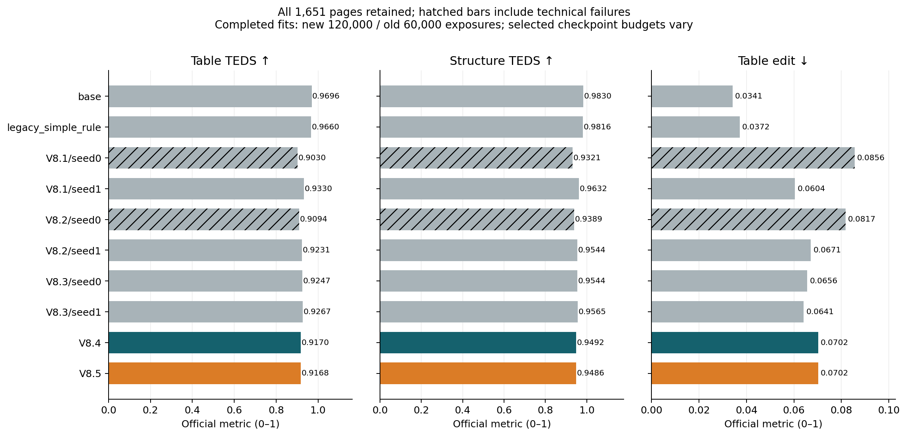
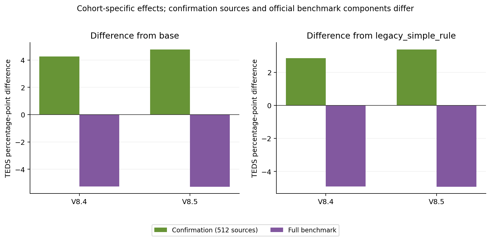
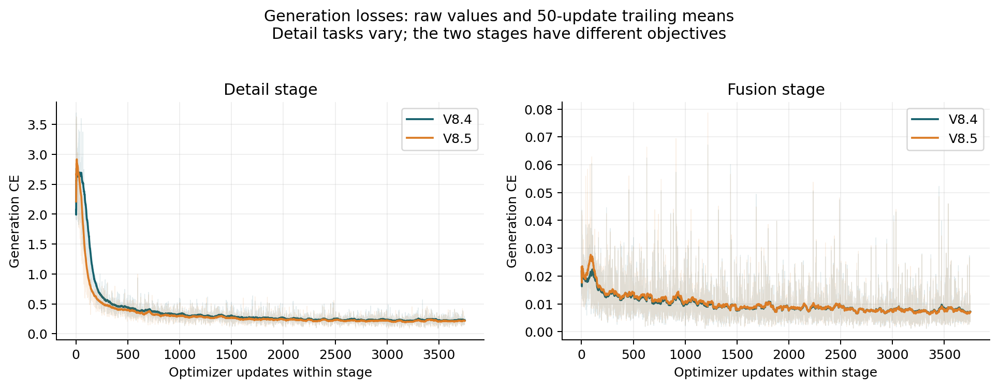
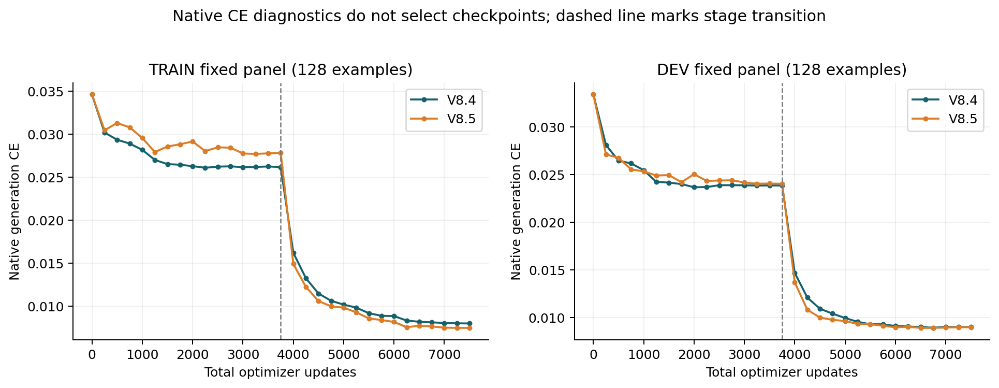
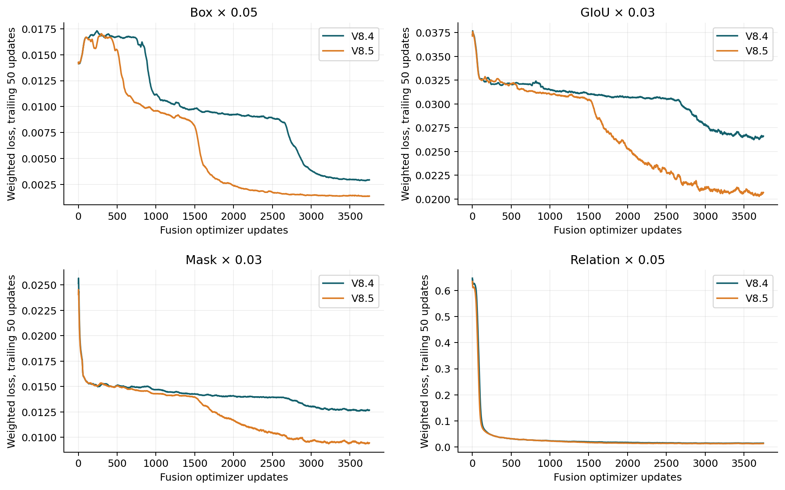
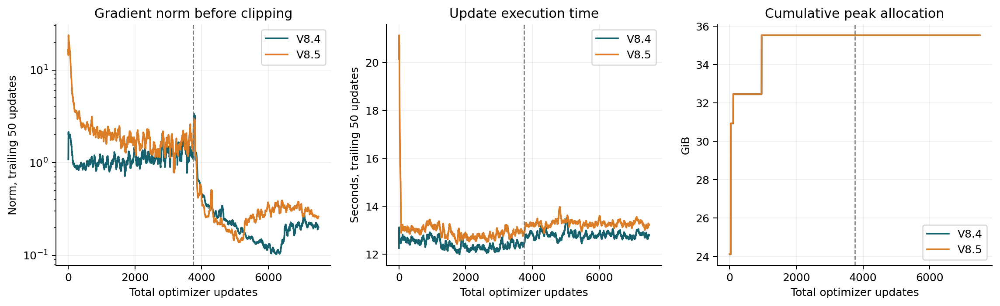
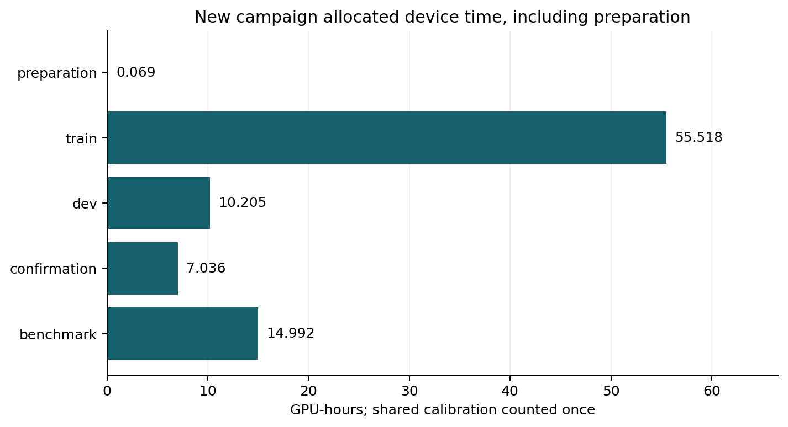

# V8.4 / V8.5: matched TDATR-style adaptation

## Material Passport

Type: computational experiment report. Status: completed saved execution and descriptive analysis. Two formal fits, one per version; no quality rerun or new checkpoint selection during reporting.

V8.4 uses ordinary LoRA; V8.5 uses LoRA-GA with the same TDATR-style detail and fusion supervision. Both completed 7,500 updates and 120,000 example exposures. Each DEV-selected checkpoint was evaluated on all 512 confirmation sources and the same 1,651 benchmark pages.

V8.4 Table TEDS is **0.9170**; its difference from the matched native base is -5.2619 percentage points, and from the legacy rule -4.9037 percentage points. V8.5 Table TEDS is **0.9168**; its difference from the matched native base is -5.2783 percentage points, and from the legacy rule -4.9201 percentage points.

In these observed full-benchmark results, both new versions are worse on all three main table metrics than the matched native reference and all four older fits without technical failures. The confirmation TEDS gains over native therefore do not carry over to this full benchmark. Lower training losses and improved auxiliary localization losses do not establish better full-benchmark table recognition.

These are local official-protocol measurements. One fit per version does not establish seed stability or a statistically reliable method advantage. Old V8.1–V8.3 full fits have 60,000 exposures. The new fitting budget is twice as large; actual selected checkpoints can precede the last epoch, as reported below.

The first benchmark attempt for each version failed before any model call because the recording wrapper used incompatible keyword names. Each attempt contained 462 failed table-containing pages and 1,189 completed non-table pages. After diagnosis, its outputs and invalid score records were deleted at the user's request; compact failure identities and costs were retained. A separately identified repair kept the frozen DEV checkpoints, page list, native inputs and scoring protocol. Only previously unexecuted table inference was performed; non-table outputs were recomposed from the same shared cache. Reported model scores below come from the repaired attempt. No successful model page was repeated.

## Eight fitted runs: table metrics first

Every fitted run is a separate row: two runs each for V8.1, V8.2 and V8.3, and one each for V8.4 and V8.5. No seed average or best-seed selection is used. In this table TEDS, structure TEDS and Overall use 0–100; Table Edit Distance uses 0–1. All eight rows retain the full 1,651-page denominator. Official table scoring covers 458 pages and 665 table rows.

| Run | Table TEDS ↑ | Structure TEDS ↑ | Table Edit Distance ↓ | Overall ↑ | Technical failures |
| --- | --- | --- | --- | --- | --- |
| V8.1/seed0 | 90.2986 | 93.2127 | 0.085605 | 84.8794 | 161 |
| V8.1/seed1 | 93.2953 | 96.3210 | 0.060427 | 96.3168 | 0 |
| V8.2/seed0 | 90.9443 | 93.8920 | 0.081719 | 85.0946 | 161 |
| V8.2/seed1 | 92.3091 | 95.4352 | 0.067085 | 95.9881 | 0 |
| V8.3/seed0 | 92.4711 | 95.4394 | 0.065634 | 96.0420 | 0 |
| V8.3/seed1 | 92.6694 | 95.6492 | 0.064097 | 96.1082 | 0 |
| V8.4 | 91.7004 | 94.9164 | 0.070172 | 95.7852 | 0 |
| V8.5 | 91.6840 | 94.8610 | 0.070156 | 95.7797 | 0 |

Matched native and legacy-rule references are retained in the full table below. The two historical seed0 failures and the doubled fitting budget of the new versions prevent an algorithm-only reading of these differences.

## Full benchmark

Overall is on a 0–100 scale; other fields are on a 0–1 scale. Higher is better for Overall, CDM and TEDS; lower is better for edit distances. Display values are rounded; the CSV retains full precision. Unavailable official fields remain unavailable. All page denominators include retained failures and empty predictions.

| Policy | Overall ↑ | Text edit ↓ | Formula CDM ↑ | Formula edit ↓ | Table TEDS ↑ | Structure TEDS ↑ | Table edit ↓ | Reading order ↓ | Technical failures |
| --- | --- | --- | --- | --- | --- | --- | --- | --- | --- |
| base | 97.5392 | 0.0297 | 0.9863 | 0.0496 | 0.9696 | 0.9830 | 0.0341 | 0.1188 | 0 |
| legacy_simple_rule | 97.4198 | 0.0297 | 0.9863 | 0.0496 | 0.9660 | 0.9816 | 0.0372 | 0.1188 | 0 |
| V8.1/seed0 | 84.8794 | 0.1299 | 0.7733 | 0.2551 | 0.9030 | 0.9321 | 0.0856 | 0.2118 | 161 |
| V8.1/seed1 | 96.3168 | 0.0297 | 0.9863 | 0.0496 | 0.9330 | 0.9632 | 0.0604 | 0.1188 | 0 |
| V8.2/seed0 | 85.0946 | 0.1299 | 0.7733 | 0.2551 | 0.9094 | 0.9389 | 0.0817 | 0.2119 | 161 |
| V8.2/seed1 | 95.9881 | 0.0297 | 0.9863 | 0.0496 | 0.9231 | 0.9544 | 0.0671 | 0.1188 | 0 |
| V8.3/seed0 | 96.0420 | 0.0297 | 0.9863 | 0.0496 | 0.9247 | 0.9544 | 0.0656 | 0.1188 | 0 |
| V8.3/seed1 | 96.1082 | 0.0297 | 0.9863 | 0.0496 | 0.9267 | 0.9565 | 0.0641 | 0.1188 | 0 |
| V8.4 | 95.7852 | 0.0297 | 0.9863 | 0.0496 | 0.9170 | 0.9492 | 0.0702 | 0.1188 | 0 |
| V8.5 | 95.7797 | 0.0297 | 0.9863 | 0.0496 | 0.9168 | 0.9486 | 0.0702 | 0.1188 | 0 |

Complete values and category breakdowns: [RESULTS.json](RESULTS.json), [METRICS.csv](METRICS.csv). V8.1/seed0 and V8.2/seed0 retain their historical 161 technical failures each; these are not clean algorithm-only controls.

## Fixed paired comparisons

The following differences use candidate minus comparator. Positive TEDS differences improve that metric; negative edit differences improve edit distance. TEDS differences are percentage points, not relative percentages.

| Candidate − comparator | Table TEDS Δ (pp) | Structure TEDS Δ (pp) | Table edit Δ | Overall Δ |
| --- | --- | --- | --- | --- |
| V8.4 − base | -5.2619 | -3.3796 | +0.036055 | -1.7540 |
| V8.4 − legacy_simple_rule | -4.9037 | -3.2482 | +0.032988 | -1.6346 |
| V8.5 − base | -5.2783 | -3.4349 | +0.036039 | -1.7595 |
| V8.5 − legacy_simple_rule | -4.9201 | -3.3035 | +0.032972 | -1.6401 |
| V8.5 − V8.4 | -0.0164 | -0.0553 | -0.000016 | -0.0055 |

All 17 frozen contrasts are retained, including each new version against all eight preserved policies. Exact sample correspondence requires the same page, GT-index group and GT-text hash, unique in both outputs. Ambiguous or unidentified examples stay unmatchable. No bootstrap, invented page Overall or favorable missing-value imputation is used.

| Table sample contrast | Improved | Worsened | Tied | Unmatchable | Comparison units |
| --- | --- | --- | --- | --- | --- |
| V8.4 − base | 44 | 410 | 211 | 0 | 665 |
| V8.4 − legacy_simple_rule | 71 | 391 | 203 | 0 | 665 |
| V8.5 − base | 44 | 409 | 212 | 0 | 665 |
| V8.5 − legacy_simple_rule | 71 | 389 | 205 | 0 | 665 |
| V8.5 − V8.4 | 129 | 147 | 389 | 0 | 665 |

Comparison units are official matched/unmatchable components, not independent documents. Metric-perfect tables are not necessarily exact output-text matches. Component-page denominators and repair/harm counts are in [PAIRED_OUTCOMES.json](PAIRED_OUTCOMES.json).

## DEV selection and confirmation

Only fusion epochs 1, 2 and 3 were eligible. Each version selected the highest mean TEDS across all 256 DEV sources, with earlier-epoch ties. The 12 original missing native inputs remain in DEV. Confirmation and benchmark scores did not select checkpoints.

| Selected policy | Completed fit exposures | Selected checkpoint exposures | Selected optimizer updates |
| --- | --- | --- | --- |
| V8.1/seed0 | 60000 | 40000 | 2500 |
| V8.1/seed1 | 60000 | 20000 | 1250 |
| V8.2/seed0 | 60000 | 60000 | 3750 |
| V8.2/seed1 | 60000 | 40000 | 2500 |
| V8.3/seed0 | 60000 | 60000 | 3750 |
| V8.3/seed1 | 60000 | 20000 | 1250 |
| V8.4 | 120000 | 100000 | 6250 |
| V8.5 | 120000 | 100000 | 6250 |

Selected-checkpoint counts differ from total fitting costs. These contrasts do not isolate the supervision change from training amount.

| Version | Fusion epoch | DEV TEDS | DEV structure TEDS | Inference | Selected |
| --- | --- | --- | --- | --- | --- |
| V8.4 | 1 | 0.9138 | 0.9176 | complete | False |
| V8.4 | 2 | 0.9156 | 0.9191 | complete | True |
| V8.4 | 3 | 0.9125 | 0.9159 | complete | False |
| V8.5 | 1 | 0.9100 | 0.9130 | complete | False |
| V8.5 | 2 | 0.9173 | 0.9208 | complete | True |
| V8.5 | 3 | 0.9164 | 0.9202 | complete | False |

| Policy | Confirmation TEDS | Structure TEDS | Exact table | Missing | Malformed |
| --- | --- | --- | --- | --- | --- |
| base | 0.8855 | 0.9119 | 0.2246 | 20 | 22 |
| legacy_simple_rule | 0.8994 | 0.9194 | 0.2969 | 20 | 21 |
| V8.1/seed0 | 0.9283 | 0.9326 | 0.6074 | 20 | 21 |
| V8.1/seed1 | 0.9318 | 0.9352 | 0.6133 | 20 | 21 |
| V8.2/seed0 | 0.9322 | 0.9351 | 0.6426 | 20 | 21 |
| V8.2/seed1 | 0.9324 | 0.9357 | 0.6367 | 20 | 21 |
| V8.3/seed0 | 0.9280 | 0.9316 | 0.6250 | 20 | 23 |
| V8.3/seed1 | 0.9331 | 0.9367 | 0.6152 | 20 | 20 |
| V8.4 | 0.9280 | 0.9319 | 0.5996 | 20 | 20 |
| V8.5 | 0.9333 | 0.9366 | 0.6172 | 20 | 20 |

The confirmation unit is one source; the full benchmark uses official component matching and aggregation. Their deltas are cohort-specific. Confirmation is reported without an advancement gate. Both test sets were exposed in earlier project work.

## Training evidence

The frozen cohort has 20,000 tables from 11,217 TRAIN sources. Each version receives three complete detail passes and three complete native OTSL fusion passes, with identical realized orders, assignments and localization-head initialization. V8.5 uses an additional 256-example gradient calibration without optimizer updates. AdamW and the cosine schedule reset between stages. No user-fixed seed or seed sweep is introduced.

Detail objectives vary across examples; the two stages do not form one stationary loss series. Faint lines are raw updates and solid lines are 50-update trailing means.

Native CE diagnostics use unchanged 128-example TRAIN and DEV panels every 250 updates, with dropout off and RNG restored. These diagnostics do not select the checkpoint.

Complete numeric update histories: [V8.4](training_curves/V8.4.csv), [V8.5](training_curves/V8.5.csv). Each contains all 7,500 optimizer updates. Inapplicable detail-stage localization fields remain blank, not zero.

[Dataset and protocol](DATASET_AND_PROTOCOL.md) records task eligibility, full sequence lengths, optimization and the explicit adaptation from TDATR. Native pre-merger and merger feature maps replace the paper backbone; this is not an exact paper reproduction.

## Cost and reconstruction

| Stage | Allocated GPU-hours |
| --- | --- |
| preparation | 0.0692 |
| dev | 10.2049 |
| benchmark | 14.9918 |
| train | 55.5178 |
| confirmation | 7.0360 |

Total new allocated GPU-hours: **87.8197**. Held-out CPU scoring elapsed time: 0.0538 hours; full official CPU scoring elapsed time: 2.0350 hours. These CPU elapsed sums are not CPU-core hours, and summed GPU allocations are not campaign wall time. Shared input preparation and old-control compute are reused, not charged again. Unlaunched queue attempts consume no GPU allocation. New calibration, discarded smoke allocations and failed benchmark attempts are included. Discarded failed-attempt CPU scoring contributes 0.9598 hours to the full scoring total.

Localization uses an extra forward on the generated OTSL and does not rewrite official text/HTML. Saved evidence reports completed replay time and unavailable counts. Failed or unavailable replay time is not separately isolated; all such cost remains inside worker/allocation totals. Text-generation call counts therefore exclude successful additional localization forwards.

V8.4: selected fusion epoch 2, 100,000 exposures at selection; complete checkpoint SHA-256 `cf2e876f7b7d845659274f1d67dec7e2de9ced6a49ba6df247cd229850e267a7`.

V8.5: selected fusion epoch 2, 100,000 exposures at selection; complete checkpoint SHA-256 `1574e4274b7a12b07ca99531625148eed7560ad5ce7298c0639d61abd74f38df`.

Both packages contain attention adapters, the trained visual merger and full localization head. V8.5 also preserves its initial compensation factors. Selected checkpoint/source hashes and complete FP32 tensor storage are verified; final packaging adds no numerical or quality rerun. The frozen implementation had already passed fresh numerical reload and annotation-free inference smoke checks. Generic final-factor-only PEFT loading and BF16 merging are not equivalent reconstruction claims. Weights remain local; [MODEL_PACKAGES.json](MODEL_PACKAGES.json) carries public metadata.

Fresh read-only checks confirm that the campaign workers, supervisors and score containers exited. Other users’ compute was not terminated. [COMPUTE_CLOSURE.json](COMPUTE_CLOSURE.json) records the verified closure scope.

## Interpretation limits

The new pair matches full-fit supervision and budgets while changing LoRA initialization; DEV-selected epochs can differ, and one realized fit does not isolate initialization from stochastic variation. Comparisons with the older trained controls also change exposure count. Retained technical failures affect some older comparisons. Previously exposed confirmation and benchmark sets do not establish fresh generalization. Transformer-native results are distinct from historical vLLM scores because presence/frequency penalties are not applied. No external leaderboard rank, statistical significance, causal supervision gain or deployment recommendation follows from these measurements.
